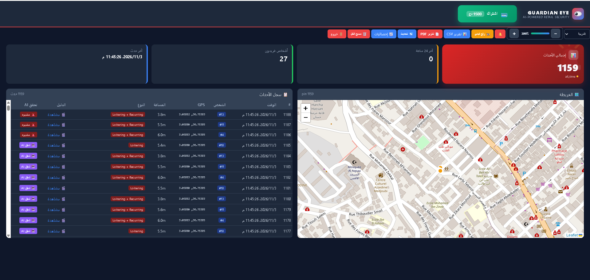
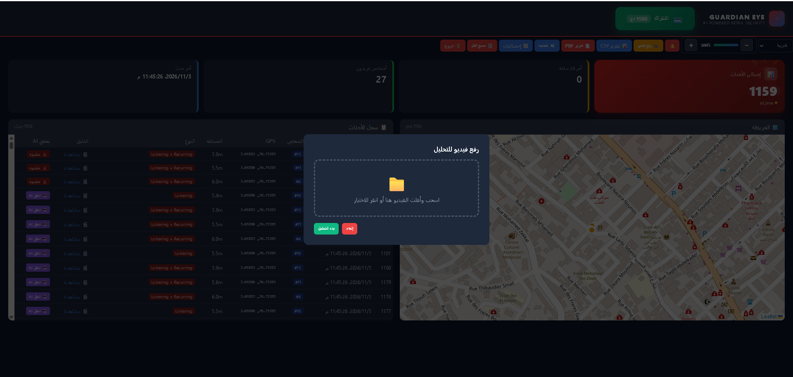
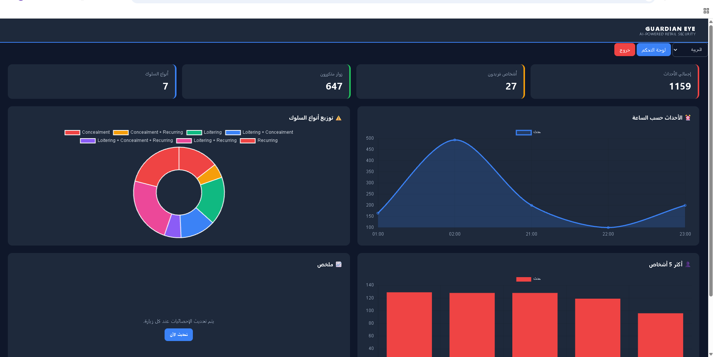

# 👁️🛡️ Guardian Eye | عين الحارس

> 🎮 **[Try the Live Demo on Render](https://guardian-eye-demo.onrender.com)** — No installation required.

---

**Retail theft costs small stores 2-3% of annual revenue. Existing AI security systems cost $50-200/month and don't speak Arabic.**

**Guardian Eye is a free, open-source shoplifting detection system that runs on a single 8GB computer. It detects loitering and concealment in real-time, sends GPS-tagged alerts, and works in Arabic, English, and French.**

**[Guardian Eye](https://github.com/https://github.com/youssoufahmad655-wq/Guardian-Eye) - Open-source Arabic-first shoplifting detection system using YOLOv8 and Qwen for real-time retail security on a single device.**

---

 ## 🚀 Quick Start

### Requirements
- Python 3.11 (recommended)
- 8 GB RAM minimum
- Windows / Linux / macOS

### Run in 4 commands

# # 📸 Screenshots

<table>
  <tr>
    <td width="50%">
      
      
<b>Dashboard</b> — Live eye, events log, interactive map

    </td>
    <td width="50%">
      
      
<b>Upload Video</b> — Drag and drop from the browser

    </td>
  </tr>
  <tr>
    <td width="50%">
      
      
<b>Statistics</b> — Hourly events, behavior types, top persons

    </td>
    <td width="50%">
      
      
<b>Video Evidence</b> — Auto-saved H.264 clips (3s before + 3s after)

    </td>
  </tr>
</table>
    
### Add Guardian Eye to the list
---

## نظرة عامة
